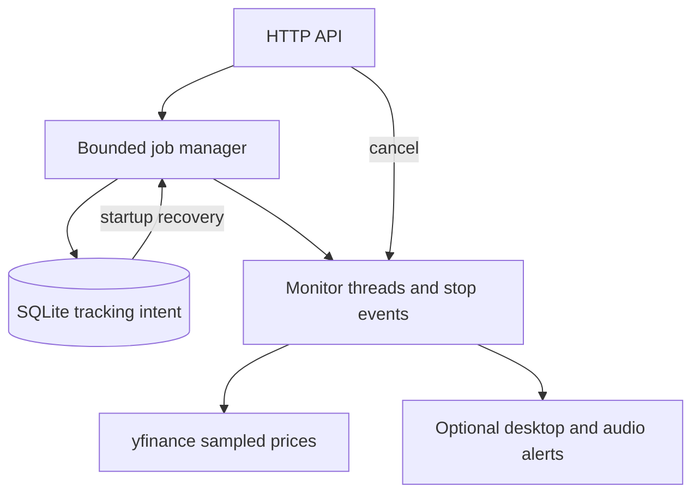

# ChartTracker API

**A FastAPI service with bounded, cancellable stock-price monitors and SQLite-backed restart recovery.** It samples prices, detects target crossings and attempts optional local desktop/audio alerts.

The HTTP layer manages tracking intent; monitor threads perform polling. SQLite retains active requests across process restarts and records cancellations and failures. This is a single-process local service, not a trading engine or distributed scheduler.

## Architecture



## Run locally

Use Python 3.10+ and a single Uvicorn worker:

```bash
python -m venv .venv
# Activate .venv for your shell.
python -m pip install -r requirements.txt
export TRACKER_API_TOKEN="$(python -c 'import secrets; print(secrets.token_urlsafe(32))')"
python -m uvicorn app.main:charttracker --host 127.0.0.1 --port 8000 --workers 1
```

All tracking endpoints require the same operator bearer token. Startup rejects missing or invalid `TRACKER_API_TOKEN` before opening the database or recovering jobs. Use a randomly generated token of 32–128 URL-safe characters; keep it out of source control and logs. Existing clients must add the Authorization header. Restart to rotate the token. The public OpenAPI docs describe the API but expose no job data. Use TLS if accessing the service beyond loopback. No token or remote secret is provisioned by this repository.

The default database is `charttracker.sqlite3` in the working directory. Set `TRACKER_DB` to a durable path for restart recovery. SQLite creates the schema automatically. Keep the same database when restarting, and avoid `--reload` for persistent monitoring. No database is opened or monitor started merely by importing the application.

Audio and desktop notifications initialize only when used; a headless machine can start the API. Missing audio/notification services are logged. Real provider and desktop behavior are not covered by the deterministic test suite.

## HTTP lifecycle

```bash
curl --fail -X POST http://127.0.0.1:8000/api/track \
  -H "Authorization: Bearer $TRACKER_API_TOKEN" \
  -H 'Content-Type: application/json' \
  -d '{"ticker":"AAPL","buy_or_sell":"buy","target_price":200,"entry_price":190}'
curl --fail -H "Authorization: Bearer $TRACKER_API_TOKEN" http://127.0.0.1:8000/api/track
# Substitute the returned job ID:
curl --fail -X DELETE -H "Authorization: Bearer $TRACKER_API_TOKEN" http://127.0.0.1:8000/api/track/JOB_ID
```

`POST` returns 202 with a job ID and acknowledges tracking intent, not successful provider retrieval. `GET` lists the request, persisted status/error and whether its monitor thread is still running. `DELETE` durably cancels an active job and signals its stop event. Repeated cancellation is safe; already-failed jobs retain their failure status and error. The response reports the stored status, and unknown IDs return 404. Capacity defaults to 32 active/stopping threads; excess submissions return 429.

Cancellation wakes the 60-second polling wait immediately. It cannot forcibly interrupt an in-flight provider call. Price requests supply a ten-second provider timeout, and monitors check cancellation before emitting alerts. Shutdown waits up to 15 seconds; a delayed provider may finish later on a daemon thread. Active tracking intent remains durable during normal shutdown and is reconstructed at next startup. Cancelled and failed jobs are not restarted automatically. Do not launch a replacement instance against the same database while the old process is still running.

## Monitoring behavior

Requests normalize ticker and side, restrict side to buy/sell, and require finite positive prices. Missing, invalid or failed quotes produce no alert and retain the retry wait. Consecutive valid sampled prices determine target crossings. Each monitor uses a monotonic 300-second alert cooldown; local Win/Lose playback compares the latest price with the entry price.

Crossings between samples can be missed. Restart recovery preserves the tracking request, not the last sampled price or cooldown timestamp. Multiple jobs share the optional pygame mixer. No trades or remote notifications are submitted.

## Verification

```bash
python -m pip install -r requirements-dev.txt
python -m unittest discover -s tests -v
```

Thirteen tests cover input validation, headless import, invalid quote handling, retry pacing, interruptible waits, capacity, HTTP create/list/cancel behavior, restart reconstruction and persisted monitor failures, including cancellation attempts against terminal failures. Tests use real temporary SQLite databases and controlled monitor/provider/audio boundaries. CI runs the same suite. Live market retrieval, desktop alert delivery, concurrent load and formal verification remain unverified.

## Limits and next work

- Single-process ownership is required. There are no leases between multiple Uvicorn workers or instances.
- One shared operator credential: no individual accounts, per-user ownership, rate limits or request idempotency keys. Repeated POSTs create separate jobs up to capacity.
- Dependencies remain unpinned; compatibility locking and dependency scanning are separate work.
- Historical jobs have no retention cleanup; add it before long-running use.
- Alert delivery is best effort. Durable delivery receipts and persisted crossing state would be needed for stronger alert guarantees.

**Ownership:** Albert Mejooli's [initial implementation](https://github.com/Albert-bit07/charttracker-api/commit/2000ea90362c01881ca39b0e725fa602de48e0b1); subsequent lifecycle work is recorded in PR history.


### Failure-state persistence

If a worker exits but SQLite cannot record its failure, the manager logs the
storage error, attempts rollback and releases the finished thread's bookkeeping.
The last committed `active` intent remains visible with `running: false` and
can be cancelled or recovered on restart. Admission counts the union of durable
active intents and running threads, including cancelled workers still finishing
a provider call. This prevents failed status writes from silently freeing durable
capacity or causing recovery to exceed the configured limit.

A storage failure is not a successful terminal-state write. If rollback also
fails, it is logged and the database needs operator investigation; this does not
provide recovery from arbitrary disk corruption. Live provider/device behavior
is separate from the local injected-failure tests.
