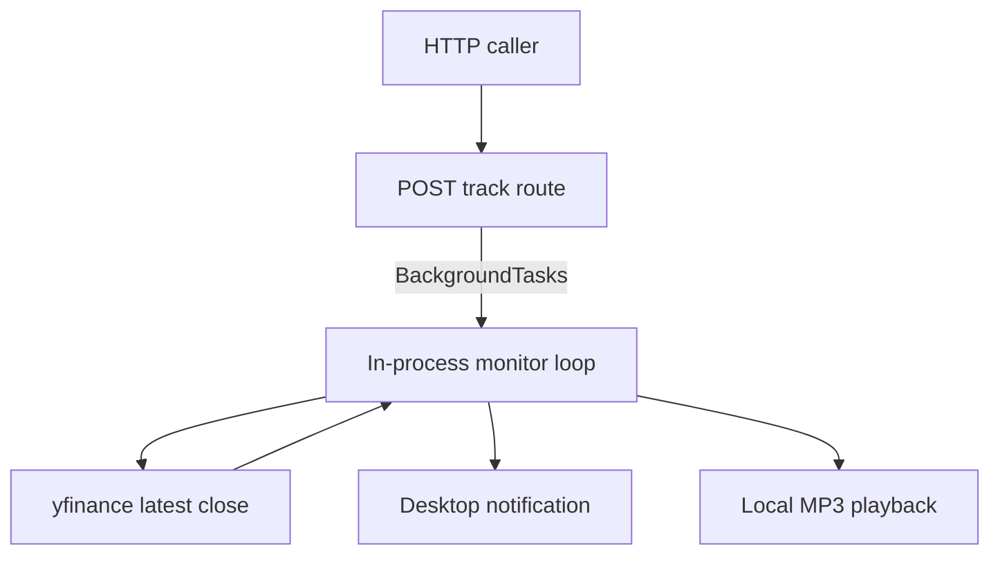

# ChartTracker API

**A FastAPI desktop prototype that starts an in-process stock-price polling loop and raises local alerts when a sampled price crosses a target.**

This evolves the [interactive Chart-tracker script](https://github.com/Albert-bit07/Chart-tracker) into an HTTP entry point. It demonstrates API/background-task separation, not a trading engine or durable job service.

- Accepts a ticker, target, entry price and buy/sell label through `POST /api/track`.
- Samples the latest one-minute close returned by yfinance approximately every 60 seconds.
- Detects upward/downward target crossings between consecutive samples.
- Applies a 300-second alert cooldown and plays local Win/Lose audio based on entry-price comparison.

**Ownership:** Albert Mejooli's [initial implementation commit](https://github.com/Albert-bit07/charttracker-api/commit/2000ea90362c01881ca39b0e725fa602de48e0b1). **Stack:** Python · FastAPI/Pydantic · yfinance · pygame · plyer. No frontend, authentication, database or external notification delivery is implemented.

## Architecture



Source-derived illustration. The [route](app/routes.py) queues [monitor_stock](app/services/monitor.py), which compares the previous and current prices. [finance.py](app/utils/finance.py) handles retrieval errors by logging and waiting 60 seconds. [notifier.py](app/services/notifier.py) initializes audio at import time and resolves MP3 files relative to the process working directory.

## Setup

Use a desktop Python environment (3.10+ for the union type syntax), audio output and a notification service. From this repository root:

```bash
python -m venv .venv
# Activate the environment for your shell.
python -m pip install -r requirements.txt
python -m uvicorn app.main:charttracker --host 127.0.0.1 --port 8000
```

The ASGI object is `charttracker`, not `app`. Visit `http://127.0.0.1:8000/docs`. In a separate terminal:

```bash
curl --fail -X POST http://127.0.0.1:8000/api/track \
  -H 'Content-Type: application/json' \
  -d '{"ticker":"AAPL","buy_or_sell":"buy","target_price":200,"entry_price":190}'
```

These are sample request values, not a recommendation or a promise of a crossing. A successful response acknowledges scheduling only; it does not prove data retrieval or an alert. No trade is submitted.

## 60–90 second demonstration plan

Start in a disposable local environment. Show `/docs`, submit one request, and show the monitor's actual log if it starts. Explain the previous/current comparison and cooldown in source. A real crossing depends on external data and cannot be guaranteed during a short recording. If no crossing occurs, say so; do not fake a notification. Do not create many monitors while recording. Stop only the server you started; its unbounded task may prolong graceful shutdown, so use your process manager's bounded stop for that child process if necessary.

No recording, screenshot or live data/notification run was verified in this review.

## Tradeoffs and limitations

Tasks live in the web process: no persistence, cancellation endpoint, deduplication, resource limit, restart recovery or job status exists. Each accepted request can occupy a thread indefinitely. Multiple jobs share one pygame mixer. Desktop imports can fail on a headless server before the API starts. Alert cooldown is local to a monitor; crossings between polling samples can be missed. Inputs have basic Pydantic types but no constrained action enum or positive-price checks. There is no authentication or rate limiting; keep this prototype local.

The success path waits 60 seconds between polls; retrieval failure also waits inside `get_current_price`. Alerts do not establish real-time exchange data or profitability. External provider availability, market hours, missing rows and desktop permissions affect behavior. Dependencies are unpinned. No latency, reliability or load evidence is provided.

## Validation — 2026-10-20

All six Python source files parsed successfully with Python AST. FastAPI, yfinance and pygame were absent, so the server, network fetch, background lifecycle and desktop/audio notifications were not executed. No tests, CI workflow, benchmark or AGENTS.md was found in the checked tree. This is a supporting learning project; prefer Choreo Log and the larger application projects as recruiting showcases.

## Runtime repairs and verification

Requests normalize ticker/side text and reject empty symbols, unsupported sides and non-positive or non-finite prices. Audio initializes only when an alert plays; missing desktop services no longer prevent API startup. Empty/invalid quotes return `None`, and the monitor waits 60 seconds before retrying. Cooldowns use monotonic time. Audio paths resolve relative to the repository.

Run `python -m unittest discover -s tests -v`. Five tests cover startup, request validation/normalization, invalid quote data and retry pacing. Tests use mocked market data and audio; no live market or desktop notification result is claimed. This remains a local prototype: each request starts an unbounded background task, with no cancellation, persistence, deduplication, authentication or worker limit. Do not expose it as a public tracking service.
